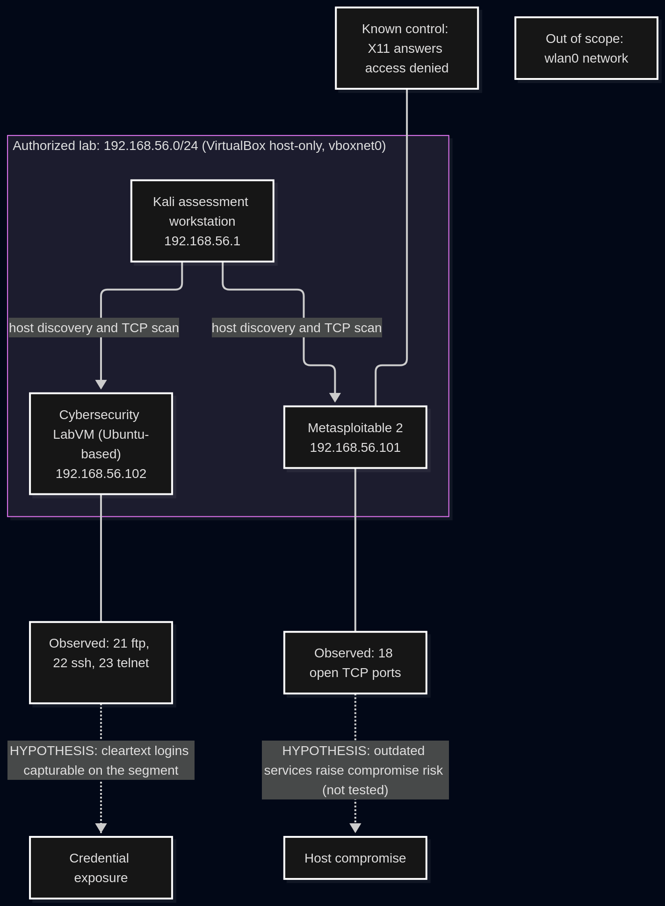

# Attack Surface Assessment Report: Eselsa Technologies

**Prepared by:** Nnodum Amarachi (student analyst)
**Assessment period:** October 2026
**Type:** Training exercise on a simulated organization

## 1. Executive summary
This report presents the results of an authorized attack surface mapping exercise for the fictional company Eselsa Technologies. Two systems in an isolated virtual lab were assessed: a Linux training workstation (the Cybersecurity LabVM, 192.168.56.102) and a deliberately vulnerable training machine (Metasploitable 2, 192.168.56.101). Only host discovery, TCP port scanning and service identification were performed. Nothing was exploited.

Seven findings were recorded: one Critical, three High, two Medium and one Low. The most important are that Metasploitable 2 exposes 18 TCP services running old software versions, that both machines offer unencrypted remote login services (Telnet on both, plus rlogin and rsh on Metasploitable 2), and that the LabVM runs FTP and Telnet in addition to SSH.

The main recommendations are to keep the vulnerable training machine isolated from every other network, disable Telnet and the legacy remote login services, restrict the database services, and repeat this assessment after any change.

How to read this report: "Observed" means a saved file in the evidence folder shows it. "Hypothesis" means reasoning that was not tested. "Unverified" means it was not checked. No vulnerability was tested or confirmed.

## 2. Assessment objectives
Management asked five questions: which assets are present, which network services are exposed, which exposures may present security risk, which findings need the most urgent attention, and what management should do to reduce the attack surface.

## 3. Authorization and scope
The scope was approved by my instructor, Dennis Gozie (Digital-Eselsa), on 21 October 2026. The authorized subnet was 192.168.56.0/24, a VirtualBox host-only network, with two authorized targets: 192.168.56.101 and 192.168.56.102.

Permitted: host discovery, TCP port scanning, service identification, manual service exposure review, local listening-service review on machines I own, HTTP header inspection, and passive packet capture inside the lab. Prohibited: exploitation, password attacks, denial-of-service testing, bypassing authentication, intrusive scan options, and scanning anything outside the lab. Excluded: the Wi-Fi network connected to the Kali workstation (wlan0, 192.168.204.0/24), the router, and every other device on it. All testing stayed within this scope. Details are in SCOPE.md.

## 4. Lab architecture
| Role | Machine | IP address | Network |
|---|---|---|---|
| Assessment workstation | Kali Linux | 192.168.56.1 | vboxnet0 (host-only) |
| Target | Cybersecurity LabVM (Ubuntu-based) | 192.168.56.102 | host-only |
| Target | Metasploitable 2 | 192.168.56.101 | host-only |

The Kali workstation also has a Wi-Fi interface for internet access. It is not part of the lab and was never scanned. See section 8 for the diagram.

## 5. Methodology and tools
- **ip and ping:** identified the interface connected to the lab (vboxnet0) and tested basic reachability, so scans used the right network. A failed ping alone proves nothing.
- **nmap:** host discovery (-sn), a TCP connect scan of the 100 most common ports (-sT), and service and version identification (-sV) on the open ports found. No exploitation scripts were used.
- **ss and systemctl:** listed the services listening on the LabVM and their binding addresses, and confirmed the SSH service state, to compare with the remote scan.
- **curl:** retrieved HTTP response headers from the authorized web service on Metasploitable 2.
- **Wireshark:** captured discovery and scan traffic on vboxnet0 to see what scanning looks like to a defender.
- **Markdown, Mermaid and Git:** documentation, the diagram, and the submission.

## 6. Asset inventory
| IP address | Observed status | Role | Evidence |
|---|---|---|---|
| 192.168.56.1 | Online (the Kali workstation itself) | Security assessment workstation | Local interface vboxnet0 from ip -br addr |
| 192.168.56.101 | Online | Deliberately vulnerable training target (Metasploitable 2) | Nmap MAC address 08:00:27:2A:E5:4D, which matches the address shown on the machine's own console |
| 192.168.56.102 | Online | Linux training workstation (Cybersecurity LabVM) | Nmap MAC address 08:00:27:55:44:07, which matches the address shown on the machine's own console |

Hostnames were not taken from Nmap banners, which are unreliable. Full detail is in ASSET_INVENTORY.md.

## 7. Discovered ports and services
**Cybersecurity LabVM (192.168.56.102):** TCP 21 (vsftpd 2.0.8 or later), 22 (OpenSSH 8.9p1 Ubuntu 3ubuntu0.1) and 23 (Linux telnetd). A local review with ss showed the same three services listening on all interfaces, with Telnet started by xinetd. The DNS stub on 127.0.0.53:53 listens on the loopback address only and was correctly invisible from Kali. NTP (UDP 123) and the DHCP client (UDP 68) were not compared because UDP scanning was outside the approved scope, so their remote reachability is unverified.

**Metasploitable 2 (192.168.56.101):** 18 open TCP ports.

| Port | Service | Version reported by Nmap |
|---|---|---|
| 21 | ftp | vsftpd 2.3.4 |
| 22 | ssh | OpenSSH 4.7p1 Debian 8ubuntu1 |
| 23 | telnet | Linux telnetd |
| 25 | smtp | Postfix smtpd |
| 53 | domain | ISC BIND 9.4.2 |
| 80 | http | Apache httpd 2.2.8 (Ubuntu) DAV/2 |
| 111 | rpcbind | version 2 (RPC 100000) |
| 139 | netbios-ssn | Samba smbd 3.X - 4.X |
| 445 | netbios-ssn | Samba smbd 3.X - 4.X |
| 513 | login | OpenBSD or Solaris rlogind |
| 514 | shell | Netkit rshd |
| 2049 | nfs | version 2-4 (RPC 100003) |
| 2121 | ftp | ProFTPD 1.3.1 |
| 3306 | mysql | MySQL 5.0.51a-3ubuntu5 |
| 5432 | postgresql | PostgreSQL 8.3.0 - 8.3.7 |
| 5900 | vnc | VNC (protocol 3.3) |
| 6000 | X11 | access denied |
| 8009 | ajp13 | Apache Jserv (protocol 1.3) |

An open port is an exposure to assess, not automatically a vulnerability. The full inventory and the attack surface classification are in SERVICE_INVENTORY.md.

## 8. Attack surface diagram

The diagram shows the Kali workstation, both targets, the host-only subnet boundary, the observed services, the one known control (X11 answered access denied on Metasploitable 2), and the excluded Wi-Fi network. Dotted lines are hypotheses that were not tested. The editable source is diagrams/attack-surface-map.mmd.

## 9. Risk assessment and prioritized findings
Risk score is likelihood multiplied by impact, using the exercise rubric.

| ID | Finding | Score | Priority |
|---|---|---|---|
| ASM-04 | Outdated service versions on Metasploitable 2 | 9 | Critical |
| ASM-01 | Telnet exposed on the LabVM | 6 | High |
| ASM-03 | Legacy remote login services on Metasploitable 2 (telnet, rlogin, rsh) | 6 | High |
| ASM-05 | Database services reachable on Metasploitable 2 | 6 | High |
| ASM-02 | FTP exposed on the LabVM | 4 | Medium |
| ASM-06 | Vulnerable training machine shares a subnet with the LabVM | 4 | Medium |
| ASM-07 | NTP on the LabVM, remote reachability unverified | 1 | Low |

ASM-04 is based on version numbers only. Nothing was tested, and support status must be confirmed on vendor end-of-life pages. The evidence, assumptions and rationale for every finding are in RISK_ASSESSMENT.md.

## 10. Recommended mitigations
1. Keep Metasploitable 2 isolated on the host-only network and never connect it to a production network. On a real system, upgrade or retire it (ASM-04).
2. Disable Telnet on the LabVM and use SSH (ASM-01), and disable telnet, rlogin and rsh on Metasploitable 2 (ASM-03).
3. Restrict MySQL and PostgreSQL to localhost or the application server (ASM-05).
4. Disable FTP on the LabVM or replace it with SFTP, and place vulnerable training machines on a separate segment (ASM-02, ASM-06).
5. Confirm whether NTP is needed (ASM-07).
6. After any change, repeat the approved scans to verify the exposure is gone.

The full plan, with responsible roles and verification methods, is in REMEDIATION_PLAN.md. Nothing was changed on any system during this assessment.

## 11. Limitations and unverified assumptions
- Only the 100 most common TCP ports were scanned, so services on other ports were not assessed.
- UDP was not scanned, because it was outside the approved scope.
- ICMP can be filtered, so a missing ping reply would not prove a host is down.
- Service versions come from Nmap banners and may be incomplete or inaccurate. Support status and known vulnerabilities for each version were not independently verified.
- No authentication, anonymous access, passwords or web application content were tested.
- Host firewall rules were not inspected.
- The assessment is a single point-in-time observation.
- Local listening services were reviewed on the LabVM only, not on Metasploitable 2.
- Wireshark visibility depends on the VirtualBox network mode and the interface monitored.

## 12. Conclusion
The assessment identified a larger attack surface on the training machine than on the LabVM, as expected for a deliberately vulnerable system. The most actionable results are the unencrypted remote login services on both machines, and the need to keep the vulnerable training machine isolated. Because this was a mapping exercise, the results are exposures and risks, not confirmed vulnerabilities. Repeating the assessment after the recommended changes would confirm that the attack surface has been reduced.

## 13. Evidence references
- Scope and approval: SCOPE.md and the approval screenshot in evidence/screenshots/
- Network configuration: evidence/local/ (ip output) and evidence/screenshots/
- Host discovery, top-100 scans and service scans of both targets: evidence/nmap/
- Local listening services, SSH status and HTTP headers: evidence/local/
- Packet capture and explanation: evidence/wireshark/attack-surface-discovery.pcapng and evidence/wireshark/README.md
- Diagram: diagrams/attack-surface-map.png and diagrams/attack-surface-map.mmd
- Screenshots of each task: evidence/screenshots/
